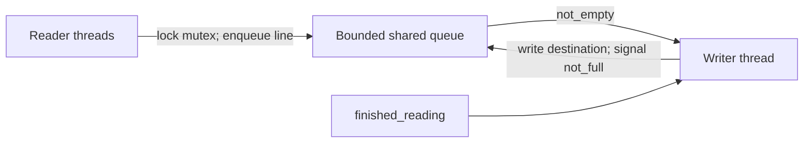

# Concurrent File Copy

**Original repository:** [LabibaShaikh/OSP_A1](https://github.com/LabibaShaikh/OSP_A1)

## Overview

Operating-systems project implementing single-file and multi-file copy programs. The multi-threaded path uses multiple readers, one writer and a bounded shared queue.

## Engineering design



`pthread_mutex_t` protects queue and file-stream access. `not_full` blocks readers when the queue reaches its capacity; `not_empty` blocks the writer while there is no work. The completion flag lets the writer terminate only after all readers finish and the queue drains.

## Technologies

C++, POSIX threads, mutexes, condition variables, standard file streams, Make and Shell.

## Contribution and attribution

The original README identifies Shaikh Naima Labiba and Jessica Bath and describes both tasks as pair-programming work. This portfolio presents the implementation as collaborative rather than assigning the entire design to one person.

## Build and run

```bash
make
./mmcopier 3 source_dir dest_dir
./src/mscopier 3 input.txt output.txt
make clean
```

`mscopier` accepts 2–10 reader threads. `generate_text.sh` can create sample input:

```bash
./src/generate_text.sh 30 > input.txt
```

## Validation

The repository includes sample source/destination files and assignment instructions, but no automated test runner. A current build was verified locally with `make`; behavior should be checked by comparing source and destination files for multiple thread counts.

## Engineering limitations and future work

The shared queue stores line numbers, but the writer currently writes FIFO queue arrival order rather than sorting by line number. Because readers acquire the input stream under the mutex, this may not preserve original line order in all schedules. A production-quality version would define an ordering contract, add a deterministic verification test, check all pthread return codes and use RAII-style cleanup.
