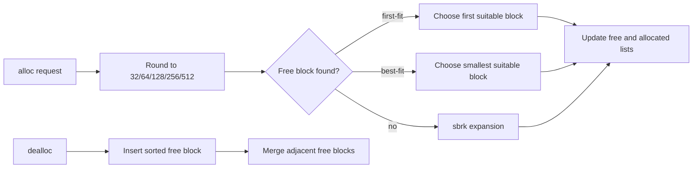

# Memory Allocation Simulator

**Original repository:** [LabibaShaikh/OSP_A3](https://github.com/LabibaShaikh/OSP_A3)

## Overview

C++ simulation of fixed-partition memory allocation. It compares first-fit and best-fit policies while tracking allocated and free blocks in linked lists.

## Engineering design



The allocator rounds requests to fixed partition sizes, splits a selected free block, returns it to the allocated list, and coalesces released blocks. First-fit prioritises search speed; best-fit minimises the immediate leftover size but may increase fragmentation elsewhere.

## Technologies

C++, `std::list`, pointer arithmetic, `sbrk`, Make, Linux/WSL and `bc` for the supplied test-data generator.

## Contribution

The original README identifies Shaikh Naima Labiba as the author and documents the allocation, deallocation, first-fit, best-fit and test-data workflow.

## Build and run

```bash
make all
./bin/firstfit datafile
./bin/bestfit datafile
./p2_gen.sh 20 > datafile
make clean
```

The generator requires the system `bc` utility. If it is unavailable, use an existing command file or install `bc` before running `p2_gen.sh`.

## Validation

The project includes a Makefile and generated command sequences. A current build was verified locally with `make`; the generator-driven behavioral comparison was not claimed as a complete test suite.

## Engineering limitations and future work

The implementation uses global lists and `sbrk`, which are useful for demonstrating allocator mechanics but are not appropriate for modern general-purpose allocation APIs. Coalescing uses an address tolerance rather than a strict adjacency invariant; a stronger implementation would track exact block boundaries, validate double frees and isolate allocator state behind a typed manager.
