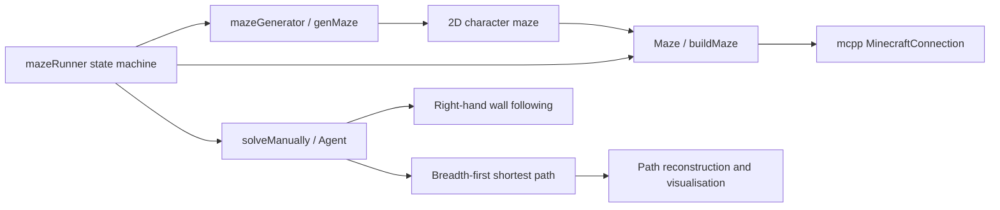

# Minecraft Maze Runner

**Original repository:** [COSC2804 SEP 2023 Assignment 3 — Team 58](https://github.com/rmit-computing-technologies/cosc2804-sep-23-assignment-3-team-58-cosc2804-sep23)  
**Team:** BitBusters

## Overview

Collaborative C++ application integrated with a Minecraft Spigot 1.19.4 server. Users can define or generate a maze, build it in Minecraft, navigate manually and display an escape route.

## Architecture and algorithms



- Recursive backtracking carves randomized perfect mazes.
- Right-hand wall following provides the normal escape-route behavior.
- Enhancement 2 uses breadth-first search and previous-node references to reconstruct a shortest route.
- `mcpp::MinecraftConnection` handles player position, block reads/writes and commands.

## Documented contribution

The source README maps `LabibaShaikh` to `s3954789` and records:

- Collaboration on maze initialization and recursive-backtracking logic
- The `Labiba_menu` branch menu-navigation implementation
- Enhancement 2 shortest-escape-route development and integration
- Debugging route-visualisation issues in Minecraft
- Contributions to shared test cases

The final program was collaborative; the source README distinguishes teammates' branch work.

## Build and run

```bash
make
./mazeRunner
./mazeRunner -testMode
./mazeRunner -E1
./mazeRunner -E2
```

Requires C++17, the external `mcpp` library and a running Minecraft Spigot 1.19.4 server. The build was not possible in this environment because `mcpp/mcpp.h` is unavailable.

## Testing

`Tests/` contains input/output fixtures for invalid input, dimensions, terminal maze loading, menu options, manual solving, route display and solve-before-build behavior. The full harness was not run because the external dependency and Minecraft environment are unavailable.

## Challenge and tradeoff

The route visualisation had to remain consistent with a live Minecraft world while integrating with existing menu and maze-building code. The project supports both a simple wall-following strategy and a BFS shortest-route enhancement, trading implementation simplicity for optimal path length.
