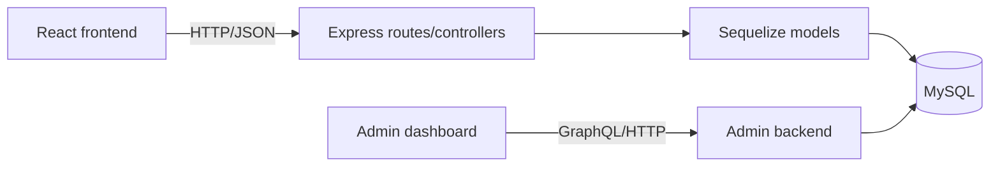

# Soil Organics Platform

**Original repositories:** [frontend/backend project](https://github.com/rmit-fsd-2024-s1/s3954789-s3946776-a2) · [admin portal](https://github.com/rmit-fsd-2024-s3946776-a2-HD)

## Overview

Collaborative full-stack grocery platform with a React frontend and Node.js/Express backend. The documented feature set covers products, shopping flows, authentication, reviews, following users and administrative moderation.

## Architecture



The source is split into `soil-frontend`, `soil-express` and the separate admin-dashboard snapshot. Controllers and Sequelize models provide the backend persistence boundary; React components and data helpers consume the API.

## Technologies

React, JavaScript, Node.js, Express, Sequelize, MySQL, Axios, React Router and Jest/React Testing Library.

## Contribution and attribution

The source README identifies Shaikh Naima Labiba and Sadf Gul as team members. This portfolio does not assign individual feature ownership without a contribution record.

## Setup

The original instructions require separate frontend and backend processes:

```bash
cd soil-express
npm install
set -a
source .env
set +a
node server.js

cd ../soil-frontend
npm install
npm start
```

Copy `soil-express/.env.example` to `soil-express/.env` and replace every placeholder with local database settings before starting the backend. The backend now fails explicitly when required database variables are absent; no database endpoint or password is included in this snapshot. The admin backend uses the same variables; copy its `.env.example` before starting it. Do not expose database variables through the React application's `REACT_APP_*` build variables.

The recipe search uses `REACT_APP_SPOONACULAR_API_KEY` if configured locally. Because React build variables are delivered to the browser, treat that key as public and use a restricted/rotatable key; it is not included in this repository.

## Testing

The frontend includes `ReviewModal.test.js` and `ShoppingCart.test.js`, with `npm test` documented by the source project. The backend package currently declares no real test command.

## Security and maintainability findings

The original snapshot contained hard-coded database connection details in both backend configurations. They have been replaced with required environment variables in this portfolio snapshot. Any credential previously used with the original host must still be rotated by its owner because it was present in the source history. The server also registers cart routes through more than one path, which should be consolidated and covered by integration tests.
