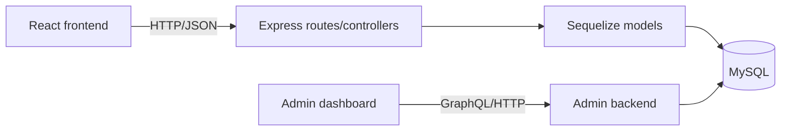

# Soil Organics Platform

**Original repositories:** [frontend/backend project](https://github.com/rmit-fsd-2024-s1/s3954789-s3946776-a2) · [admin portal](https://github.com/rmit-fsd-2024-s3946776-a2-HD)

## Overview

Collaborative full-stack grocery platform with a React frontend and Node.js/Express backend. The documented feature set covers products, shopping flows, authentication, reviews, following users and administrative moderation.

## Architecture



The source is split into `soil-frontend`, `soil-express` and the separate admin-dashboard snapshot. Controllers and Sequelize models provide the backend persistence boundary; React components and data helpers consume the API.

## Technologies

React, JavaScript, Node.js, Express, Sequelize, MySQL, Axios, React Router and Jest/React Testing Library.

## Contribution and attribution

The source README identifies Shaikh Naima Labiba and Sadf Gul as team members. This portfolio does not assign individual feature ownership without a contribution record.

## Setup

The original instructions require separate frontend and backend processes:

```bash
cd soil-express
npm install
node server.js

cd ../soil-frontend
npm install
npm start
```

The backend requires a configured MySQL database. The admin portal has its own package manifest and startup instructions.

## Testing

The frontend includes `ReviewModal.test.js` and `ShoppingCart.test.js`, with `npm test` documented by the source project. The backend package currently declares no real test command.

## Security and maintainability findings

The copied backend configuration contains hard-coded database credentials. Do not reuse or publish them; rotate the credential and move configuration to environment variables before any further distribution. The server also registers cart routes through more than one path, which should be consolidated and covered by integration tests.
